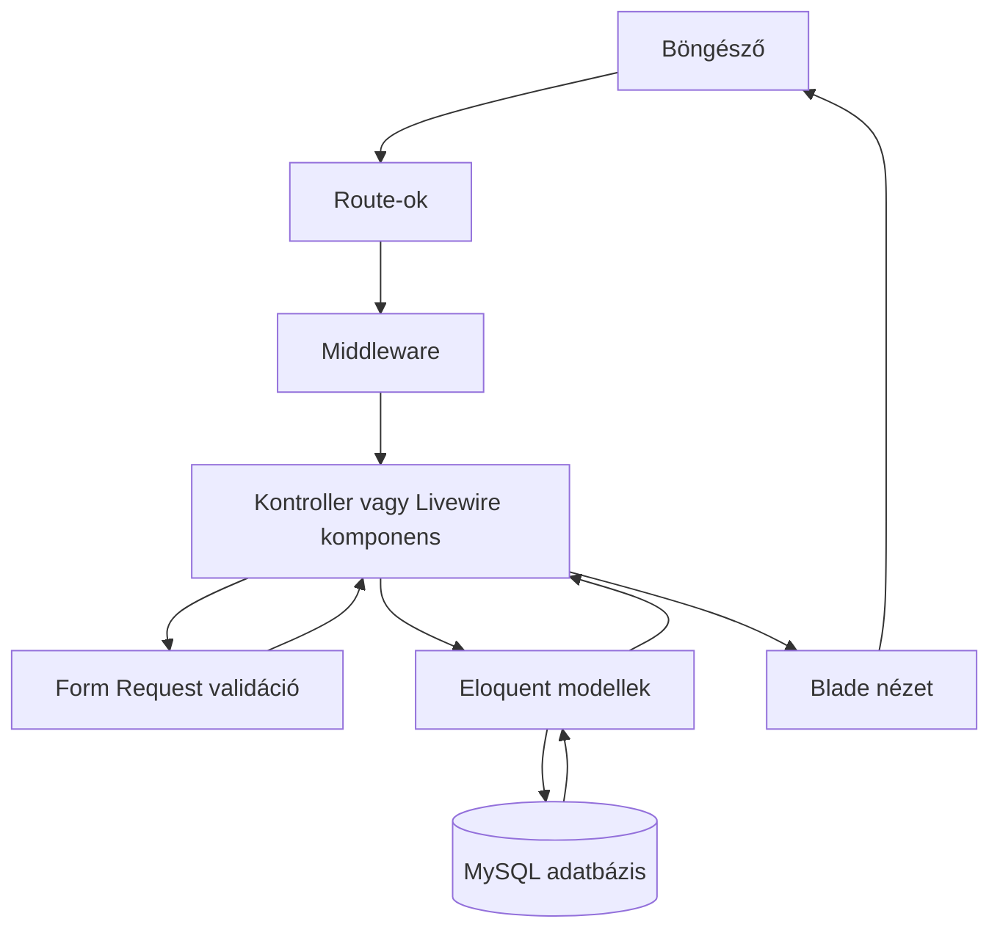

# Alpaka Farm

Az **Alpaka Farm** egy Laravelben készített gyakorló- és portfólióprojekt. Egy képzeletbeli családi alpakafarm weboldalát valósítja meg bemutatkozó oldalakkal, időpontfoglalással, webshoppal, felhasználói fiókkal és adminfelülettel.

## Képernyőképek

Képernyőképek hamarosan.

## Fő funkciók

### Látogatók

- a farm és az elérhetőségek megtekintése;
- aktív termékek böngészése és részletes adatlapja;
- session-alapú kosár kezelése;
- rendelés leadása vendégként;
- látogatási időpont foglalása;
- regisztráció és bejelentkezés.

### Regisztrált felhasználók

- saját rendelések megtekintése;
- saját időpontfoglalások követése;
- profil- és biztonsági beállítások kezelése.

### Adminisztrátorok

- összesítő admin dashboard;
- termékek létrehozása, szerkesztése és törlése;
- termékképek feltöltése és cseréje;
- termékek készletének és aktív állapotának kezelése;
- foglalások megtekintése és állapotuk módosítása;
- rendelések megtekintése és állapotuk módosítása.

## Fontosabb üzleti szabályok

- Egy időpontra összesen legfeljebb tíz látogató foglalhat.
- A lemondott foglalások nem foglalnak kapacitást.
- Csak az előre meghatározott érkezési időpontok választhatók.
- Csak aktív, megfelelő készlettel rendelkező termék rendelhető.
- A rendelés leadása tranzakcióban történik, és csökkenti a termék készletét.
- Rendelés lemondásakor a készlet automatikusan visszakerül.
- Lemondott rendelés csak akkor aktiválható újra, ha minden termékből elegendő készlet áll rendelkezésre.
- A normál felhasználók nem érhetik el az adminisztrációs felületet.

## A rendszer felépítése

| Modul | Feladata |
| --- | --- |
| Publikus oldalak | A farm bemutatása, kapcsolat és navigáció. |
| Termékkezelés | Aktív termékek listázása, részletes adatlap és adminisztrációs CRUD. |
| Kosár | A kiválasztott termékek és mennyiségek tárolása a sessionben. |
| Pénztár | Vásárlói adatok ellenőrzése, rendelés létrehozása és készletcsökkentés. |
| Foglalás | Látogatási igények rögzítése és az időpont kapacitásának ellenőrzése. |
| Felhasználói fiók | Saját rendelések, foglalások és profilbeállítások. |
| Adminfelület | Termékek, rendelések és foglalások központi kezelése. |
| Jogosultságkezelés | Vendég-, felhasználói és adminisztrátori hozzáférések elkülönítése. |

Az alkalmazás Laravel MVC-szerkezetet használ. A kontrollerek kezelik a HTTP-kéréseket, a Form Request osztályok végzik a bemenetek validálását, az Eloquent modellek biztosítják az adatbázis-kapcsolatot, a Blade nézetek pedig a felhasználói felület megjelenítését.

## Hogyan kommunikálnak egymással a részek?



Egy kérés általános útja:

1. A böngésző elküld egy HTTP-kérést.
2. A `routes/web.php` vagy a `routes/settings.php` kiválasztja a hozzá tartozó kontrollert.
3. Az `auth` és az `admin` middleware szükség esetén ellenőrzi a hozzáférést.
4. Beküldött űrlapnál egy Form Request ellenőrzi az adatokat.
5. A kontroller az Eloquent modelleken keresztül olvassa vagy módosítja az adatbázist.
6. A kontroller egy Blade nézetet vagy átirányítást ad vissza a böngészőnek.

### Példa: időpontfoglalás

```text
POST /idopontfoglalas
→ routes/web.php
→ StoreBookingRequest
→ BookingController::store()
→ Booking modell
→ bookings tábla
→ átirányítás sikerüzenettel
```

### Példa: rendelés leadása

```text
Kosár a sessionben
→ POST /penztar
→ StoreOrderRequest
→ CheckoutController::store()
→ Product, Order és OrderItem modellek
→ rendelés és tételek mentése, készlet csökkentése
→ sikeres rendelési oldal
```

A pénztári adatbázis-műveletek tranzakcióban futnak. Ha egy termék időközben elfogy vagy inaktívvá válik, a rendelés nem jön létre részlegesen, és a készlet sem módosul hibásan.

## Fontosabb fájlok

### Belépési pontok és route-ok

| Fájl | Feladat |
| --- | --- |
| `public/index.php` | A webalkalmazás belépési pontja. Elindítja a Laravelt és továbbadja neki a kérést. |
| `bootstrap/app.php` | Összeállítja az alkalmazást, betölti a route-okat és regisztrálja az `admin` middleware aliast. |
| `routes/web.php` | A publikus oldalak, termékek, kosár, pénztár, foglalás, dashboard és adminfelület route-jai. |
| `routes/settings.php` | A profil-, megjelenési és biztonsági beállítások route-jai. |

### Kontrollerek

| Fájl | Feladat |
| --- | --- |
| `app/Http/Controllers/ProductController.php` | Kilistázza az aktív termékeket és megjeleníti egy termék adatlapját. |
| `app/Http/Controllers/CartController.php` | A sessionben tárolt kosár megjelenítése, bővítése és módosítása, valamint termékek eltávolítása. |
| `app/Http/Controllers/CheckoutController.php` | Összeállítja a pénztár adatait, létrehozza a rendelést és módosítja a készletet. |
| `app/Http/Controllers/BookingController.php` | Megjeleníti a foglalási űrlapot és elmenti a foglalási igényt. |
| `app/Http/Controllers/DashboardController.php` | Betölti a felhasználó rendeléseit és foglalásait; az admint az admin dashboardra irányítja. |
| `app/Http/Controllers/PasskeyEndpointController.php` | A passkey-kezeléshez szükséges well-known végpont JSON-válaszát adja. |
| `app/Http/Controllers/Admin/DashboardController.php` | Összesítéseket, legutóbbi rendeléseket és közelgő foglalásokat tölt be az admin kezdőoldalára. |
| `app/Http/Controllers/Admin/ProductController.php` | A termékek adminisztrációs CRUD-műveleteit és a képfeltöltést kezeli. |
| `app/Http/Controllers/Admin/BookingController.php` | Kilistázza a foglalásokat és módosítja az állapotukat. |
| `app/Http/Controllers/Admin/OrderController.php` | Kilistázza a rendeléseket, kezeli az állapotváltást és az ahhoz tartozó készletváltozást. |

### Validáció és jogosultság

| Fájl | Feladat |
| --- | --- |
| `app/Http/Requests/StoreBookingRequest.php` | Ellenőrzi a foglalási adatokat, a választható időpontot és a szabad kapacitást. |
| `app/Http/Requests/StoreOrderRequest.php` | Ellenőrzi a pénztárban megadott vásárlói és szállítási adatokat. |
| `app/Http/Requests/StoreProductRequest.php` | Új termék adatainak, képének és generált slugjának validálása. |
| `app/Http/Requests/UpdateProductRequest.php` | Meglévő termék módosításának validálása az egyediségi szabályok figyelembevételével. |
| `app/Http/Middleware/AdminMiddleware.php` | Csak adminisztrátori felhasználót enged tovább az admin route-okra. |

### Modellek és adatbázis

| Fájl | Feladat |
| --- | --- |
| `app/Models/User.php` | Felhasználói adatok, valamint a felhasználó rendeléseinek és foglalásainak kapcsolatai. |
| `app/Models/Product.php` | Termékadatok, készlet, ár, aktív állapot és kép elérési útja. |
| `app/Models/Booking.php` | A látogatási időpont, létszám, kapcsolattartási adatok és foglalási állapot. |
| `app/Models/Order.php` | Vásárlói adatok, végösszeg, fizetési mód, rendelési állapot és rendelési tételek kapcsolata. |
| `app/Models/OrderItem.php` | Egy rendelés adott termékét, mennyiségét és rendeléskori árát tárolja. |
| `database/migrations/` | Létrehozza és módosítja az adatbázis tábláit. |
| `database/seeders/ProductSeeder.php` | Kezdő termékadatokat tölt az adatbázisba. |

### Felhasználói felület

| Fájl vagy mappa | Feladat |
| --- | --- |
| `resources/views/welcome.blade.php` | Főoldal. |
| `resources/views/products/` | Webshoplista és termékadatlap. |
| `resources/views/cart/` | Kosár megjelenítése és szerkesztése. |
| `resources/views/checkout/` | Pénztár és sikeres rendelési oldal. |
| `resources/views/bookings/` | Időpontfoglalási űrlap. |
| `resources/views/dashboard.blade.php` | A bejelentkezett felhasználó rendelései és foglalásai. |
| `resources/views/admin/` | Admin dashboard, valamint a termékek, foglalások és rendelések kezelőfelülete. |
| `resources/views/layouts/` és `resources/views/components/` | Az oldalak közös szerkezete, navigációja és újrafelhasználható Blade-elemei. |
| `app/Livewire/Settings/` | A profil- és biztonsági beállítások szerveroldali Livewire logikája. |
| `resources/views/livewire/` | A bejelentkezéshez és a beállításokhoz tartozó Livewire nézetek. |
| `resources/css/public.css` | A publikus oldalak stílusai. |
| `resources/css/admin.css` | Az adminfelület stílusai. |
| `resources/css/auth.css` | A bejelentkezési és regisztrációs oldalak stílusai. |
| `resources/js/app.js` | A frontend JavaScript belépési pontja. |

### Konfiguráció és tesztek

| Fájl vagy mappa | Feladat |
| --- | --- |
| `.env.example` | A szükséges környezeti változók biztonságosan megosztható mintája. |
| `config/` | Az alkalmazás, adatbázis, session, cache, levelezés, Fortify és egyéb Laravel-szolgáltatások beállításai. |
| `tests/Feature/` | A route-okat és a teljes funkcionális folyamatokat ellenőrző automatizált tesztek. |
| `tests/TestCase.php` | A tesztek közös beállításai, köztük a Vite kikapcsolása a tesztkörnyezetben. |
| `phpunit.xml` | A PHPUnit és a memóriabeli SQLite teszt-adatbázis konfigurációja. |
| `.github/workflows/tests.yml` | A tesztek automatikus futtatása GitHub Actionsben. |

## Technológiák

- PHP 8.4
- Laravel 13
- Laravel Fortify
- Livewire
- Blade
- Eloquent ORM
- MySQL / MariaDB
- HTML5 és CSS3
- JavaScript
- Vite és npm
- PHPUnit / Laravel feature tesztek
- Git és GitHub Actions

## Fejlesztési folyamat

A projekt fejlesztése közben ChatGPT-t is használtam ötleteléshez, Laravel-funkciók megértéséhez, hibakereséshez, valamint a tesztek és a dokumentáció kialakításának támogatására. A változtatásokat helyben futtattam és automatikus tesztekkel ellenőriztem.

## Telepítés

### Előfeltételek

- PHP 8.4 vagy újabb;
- Composer;
- Node.js és npm;
- MySQL vagy MariaDB;
- a PHP szükséges Laravel-bővítményei.

### 1. Repository klónozása

```bash
git clone https://github.com/VaskoBence/alpaka-farm.git
cd alpaka-farm
```

### 2. PHP- és frontendfüggőségek telepítése

```bash
composer install
npm install
```

### 3. Környezeti fájl létrehozása

Windows PowerShellben:

```powershell
Copy-Item .env.example .env
```

Linux vagy macOS rendszeren:

```bash
cp .env.example .env
```

Ezután generáld le az alkalmazás kulcsát:

```bash
php artisan key:generate
```

### 4. Adatbázis beállítása

Hozz létre egy üres adatbázist, majd állítsd be a `.env` fájlban a kapcsolatot. Példa:

```dotenv
DB_CONNECTION=mysql
DB_HOST=127.0.0.1
DB_PORT=3306
DB_DATABASE=alpaka
DB_USERNAME=root
DB_PASSWORD=
```

Futtasd a migrációkat és a seedert:

```bash
php artisan migrate --seed
```

### 5. Publikus tárhely és frontend elkészítése

```bash
php artisan storage:link
npm run build
```

### 6. Alkalmazás indítása

```bash
php artisan serve
```

Az alkalmazás alapértelmezetten a `http://127.0.0.1:8000` címen érhető el.

Fejlesztés közben a Vite szerver külön terminálban indítható:

```bash
npm run dev
```

## Tesztelés

A tesztkörnyezet külön, memóriában futó SQLite-adatbázist használ, ezért a tesztek nem módosítják a helyi MySQL-adatbázist.

```bash
php artisan test
```

A tesztek többek között ellenőrzik:

- az adminisztrátori jogosultságokat;
- a foglalási időpontokat és kapacitást;
- a kosár működését;
- a rendelés létrehozását és a biztonságos készletváltozást;
- a rendelési állapotváltások készletre gyakorolt hatását;
- az admin termékkezelést és a képfeltöltést;
- a publikus oldalak és a felhasználói dashboard elérhetőségét.

## Továbbfejlesztési lehetőségek

- online fizetési szolgáltató integrálása;
- automatikus rendelési és foglalási e-mailek;
- foglalások naptárnézete;
- termékkeresés és kategóriák;
- éles szerveres telepítés;
- további reszponzív és akadálymentességi fejlesztések.

## Szerző

**Vaskó Bence**
